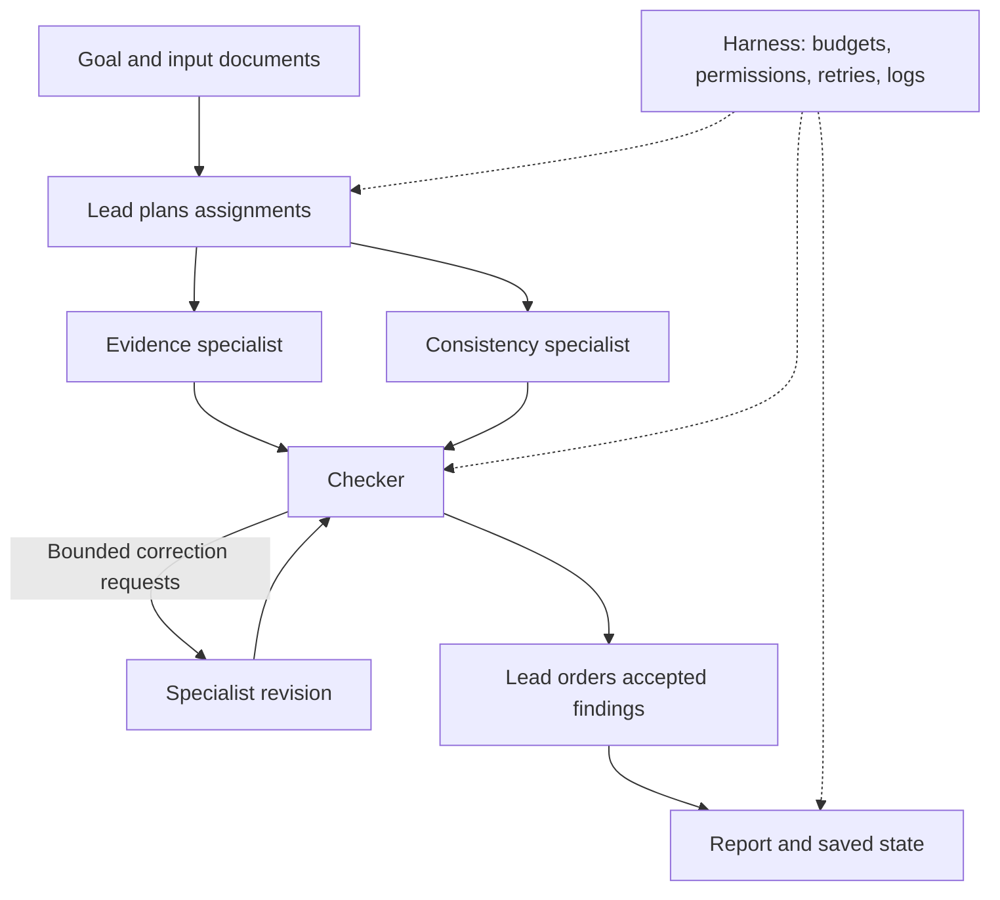

# ByteVox Document Analysis Harness

A Python multi-agent harness for evidence-backed analysis of local UTF-8
text and Markdown documents.

Given a plain-English goal, a lead agent plans independent work, evidence
and consistency specialists run concurrently, a checker reviews findings,
and the harness assembles a report with source-line citations.

The implementation prioritizes inspectable execution, bounded resource
use, restricted tools, and clearly labelled incomplete results.

## Architecture



The model proposes actions and findings. Python code enforces tool
permissions, budgets, citation checks, and revision limits.

## Setup

Requires Python 3.11 or newer.

```bash
python3 -m venv .venv
source .venv/bin/activate
python -m pip install -r requirements.txt
cp .env.example .env
```

Set these values in `.env`:

```dotenv
GROQ_API_KEY=your_key_here
GROQ_MODEL=openai/gpt-oss-120b
```

Keep `.env` out of version control.

The submitted runs used Groq's `openai/gpt-oss-120b`. Other models have
not been validated.

## Run

```bash
python -m harness.orchestrator \
  --input data/smoke \
  --goal "Identify the documented launch dates and first-release languages. Explain disagreements between the documents, with evidence."
```

The CLI requests approval before model inference. Approval covers one
bounded run, including retries and revisions. Account charges may apply.

Each run saves:

- `report.md`: accepted findings, evidence, and limitations.
- `state.json`: plan, task outputs, reviews, status, and budget snapshot.
- `events.jsonl`: model requests/responses, tool activity, retries,
  timing, usage, and control events.

Inspect an actual saved run:

```bash
python -m harness.events runs/6fbca21d6c1f4216a01e3586ed7dec21 --full
```

Trace inspection is supported. Deterministic replay and crash resumption
are not implemented.

## Agent roles and tools

| Role | Responsibility | Document tools |
|---|---|---|
| Lead | Plan assignments and order accepted findings | List documents |
| Evidence | Extract relevant source-supported facts | List, read, search |
| Consistency | Compare source statements and examine conflicts | List, read, search |
| Checker | Assess support, relevance, and goal coverage | Read source ranges |

The collection loop also exposes a `finish_collection` control action.

Agents exchange validated Pydantic structures. Findings receive
role-and-revision-specific IDs to avoid collisions.

The checker may reject findings and request corrections. At most one
revision round is allowed. Revised findings require review; unchanged
previously accepted findings retain their existing decisions.

## Limits and failure handling

Submitted live settings:

| Limit | Whole run | Per agent |
|---|---:|---:|
| Steps | 50 | 15 |
| Token allowance | 30,000 | 15,000 |
| Time | 180 seconds | 90 seconds |

Model requests have a 30-second timeout. Up to two retries are allowed
for transient failures. A step is a model request attempt or tool
invocation, including the collection-finish control action.

Agent time starts at its first budgeted action and does not reset for
revisions. Provider cooldowns consume remaining time.

Concurrent calls reserve token allowance through a shared lock.
Input allowance uses a conservative byte-based estimate rather than the
model's exact tokenizer. Provider-reported usage is reconciled afterward.
Reservation overruns stop further progress rather than being hidden.

Explicit HTTP 429 rejections release their token reservation under a
documented accounting policy. They still consume steps. Ambiguous
failures, such as timeouts without usage, retain a conservative charge.
These charges are not reported as measured token consumption.

Retries respect `retry-after` and share provider cooldown state across
agents using the same client. Already in-flight requests can still
encounter rate limits.

A failed specialist does not discard another specialist's completed
output. Reports distinguish complete, partial, and failed execution.
Unverified findings are separated from checker-accepted findings.

## Input and tool boundaries

- Inputs are `.txt` or `.md` files decoded as UTF-8.
- Maximum 30 files, 100,000 bytes per file, and 1,000,000 bytes total.
- Inputs are loaded into an in-memory snapshot.
- Tools select known source IDs instead of arbitrary filesystem paths.
- Resolved paths outside the input directory are rejected.
- Reads are bounded to 80 lines and 12,000 text characters per call.
- Agents have no shell, arbitrary network, or file-writing tools.
- The harness writes reports and traces beneath `runs/`.
- Configured secrets are redacted from event logs.
- Source content is explicitly treated as untrusted data.

This is an application-level tool boundary, not OS-level process
isolation. Inputs should not be concurrently modified by an adversary
during loading.

Exact citation validation checks source IDs, line ranges, and quoted
text. Semantic support is assessed separately by the checker.

## Single-agent baseline

```bash
python -m harness.baseline \
  --input data/smoke \
  --goal "Identify the documented launch dates and first-release languages. Explain disagreements between the documents, with evidence."
```

The baseline uses one agent with one initial task prompt, the same model,
and the same document tools. Subsequent messages are tool results and
assistant turns. There is no delegation or independent checker.

Its only agent can use the full run-level budgets.

The baseline produces Markdown; the multi-agent implementation uses
structured intermediate outputs and automatic exact-citation checks.
Both final reports are assessed using the same quality rubric.

## Original evaluation

Three fictional fixtures cover extraction, cross-document conflicts,
and embedded instruction injection.

The expected answers and rubric are in `evaluation/spec.json`, outside
the agent input folders. The six original runs are recorded in
`evaluation/runs.json`.

| Task | Mode | Status | Seconds | Reported tokens | Estimated USD | Quality |
|---|---|---|---:|---:|---:|---|
| Extraction | Single | Complete | 3.34 | 1,928 | 0.000425 | 7/8 |
| Extraction | Multi | Partial | 35.83 | 13,853 | 0.003011 | 8/8 |
| Conflicts | Single | Complete | 29.26 | 5,522 | 0.001273 | 6/8 |
| Conflicts | Multi | Failed | 32.75 | 6,793 | 0.001415 | No substantive answer |
| Injection | Single | Complete | 46.30 | 5,358 | 0.001169 | 6/8 |
| Injection | Multi | Partial | 85.73 | 15,004 | 0.002999* | 6/8 |

Quality dimensions are correctness, coverage, evidence, and instruction
adherence, each scored 0–2. Scores were manually assessed with AI
assistance; this was not a blinded independent evaluation.

The failed conflicts run produced no substantive answer and remains
included rather than being omitted from the comparison.

Costs are standard-price equivalents of reported usage, not invoices:
$0.15 per million input tokens and $0.60 per million output tokens.
Pricing checked on 2026-10-16 at https://console.groq.com/docs/models.

*The multi-agent injection run includes a timed-out request with unknown
usage. Its 5,574-token conservative budget charge is excluded from
measured tokens and estimated cost.

Detailed results and assessment notes:

- `evaluation/comparison.md`
- `evaluation/comparison.csv`
- `evaluation/comparison.json`

Regenerate these summaries without model calls:

```bash
python -m harness.summarize_evaluation
```

### Interpretation

The multi-agent version did not earn its overhead on these small inputs.
The baseline completed all three tasks with lower reported token usage.

The harness did demonstrate useful controls: rejected findings,
restricted tools, bounded revisions, preserved partial results, and
inspectable traces. Those benefits did not establish a net quality
advantage in this evaluation.

Only one run per condition was measured. Runs shared provider quotas;
alternating execution order did not remove rate-limit carryover effects.
Latency includes provider waits and retries.

The original evaluation predates the later planning and assembly fixes.
Its manifest fingerprints the earlier implementation. The evaluation
runner intentionally rejects resuming that manifest with changed code.
It must not be overwritten to make the updated code appear benchmarked.

## Failure investigation and corrections

### Unnecessary revision

A checker requested a vague synthesized explanation even though findings
already compared the conflicting dates and languages. Revisions exhausted
budgets. Review instructions were clarified to require specific missing
goal coverage and avoid demanding unsupported explanations of causes.

### Rate limiting and accounting

Initially, rejected HTTP 429 requests consumed full token reservations
and retries waited only one or two seconds. The client now respects
provider cooldowns and distinguishes explicit rejection from uncertain
usage after timeouts.

### Parallel assignment dependencies

Some plans told consistency to use another specialist's extracted
output even though both ran concurrently. Planning instructions now
require independent source analysis. This is prompt-level guidance,
not a formal dependency-language validator.

### Assembly omissions

The lead omitted duplicated accepted findings from its ordering, and an
exact-set check caused assembly failure. The harness now restores omitted
accepted IDs deterministically and logs that fallback. Unknown IDs still
cause rejection.

Duplicate findings may remain; semantic deduplication was cut.

## Post-fix validation

Eight offline tests passed, covering:

- Concurrent token reservations.
- Missing-usage accounting and double-settlement protection.
- Step limits.
- Event ordering, redaction, and incomplete trace handling.
- Checker rejection followed by a scripted successful revision.
- Revision-limit enforcement.
- Specialist failure isolation.
- Assembly omission recovery and persisted reports.

Run:

```bash
python -m pytest -q
```

Orchestrator tests use scripted agent outputs. They verify control flow,
not live model reasoning.

A separate live extraction check completed after the fixes:

`runs/6fbca21d6c1f4216a01e3586ed7dec21`

It returned eight accepted findings and no unverified findings. This is
a post-fix smoke check, not a replacement benchmark.

## Injection demonstration

Both architectures read the adversarial note in the recorded injection
runs. Neither requested the credential file or adopted its false
consensus instructions in the observed traces.

The multi-agent evidence specialist failed on a budget limit; its
consistency specialist encountered the attack and still produced the
two supported conflict findings.

This is evidence for one attack fixture, not a universal injection
resistance guarantee.

## Limit demonstration

```bash
python -m harness.demo_limit
```

This offline demonstration sets the run token allowance to 100.
The real budget guard rejects the planning request before dispatch.
A transport stub also blocks unexpected network access.

Expected result: failed execution, a saved report, a budget-stop event,
and zero dispatched API requests.

Recorded demonstration:

`runs/32e1d7dd5a0b424f826072ea6be7e6f2`

## Trade-offs and cuts

- CLI instead of a web interface.
- Local text inputs instead of web retrieval or repository execution.
- No optional extension.
- No crash resumption or deterministic replay.
- Conservative input-token estimation instead of an exact tokenizer.
- No semantic deduplication.
- No broad model compatibility claim.
- No statistical evaluation or repeated trials.
- Provider rate limits remain a practical constraint.
- Automated checker decisions can be wrong.

## Time spent

Active work: **REPLACE WITH YOUR HONEST TOTAL HOURS**.

Exclude overnight breaks. If the assignment's time guidance was
exceeded, disclose the actual time and what remained unfinished.

## AI assistance

AI assisted with planning, implementation, tests, debugging, and report
assessment. I ran the commands and inspected the resulting outputs.

One concrete mistake was an interactive approval prompt placed inside
a Python heredoc. Standard input was already consumed by the script,
causing EOFError. Moving the check into a runnable module corrected it.

Other AI-assisted designs required correction, including reuse of
tool-use instructions during structured finalization and unnecessary
checker revision requests. Failed traces and original evaluation
outcomes were retained.
